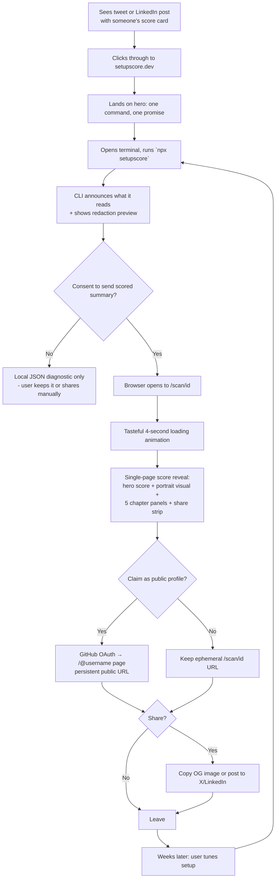

# Plan — SetupScore (Klout for Claude Code)

**Date:** 2026-04-24 (revised: zero-revenue, PLG-only, one-page, score-only)
**Tier:** T2 · S3
**Related:** [research.md](research.md) · [PRD.md](PRD.md)

---

## 1. What we are building, restated in one paragraph

A developer runs `npx setupscore`. The CLI — open-source, local-only, no network — reads their `~/.claude/` directory, redacts secrets against a published pattern list, and prints a diagnostic. On their consent, the scored summary (never raw files) is sent to `setupscore.dev` and they land on a single-page visual portrait of their setup: a score, a bespoke visualization, five short "chapters" of story, a tasteful OG card for LinkedIn/X, and nothing else. No recommendations, no dashboard, no paid tier, no email capture. They may rescan whenever. That's the whole product.

---

## 2. User journey (mermaid)

---

## 3. Platform + stack

**Platform:** Web + local CLI. Same rationale as before — local scan is non-negotiable for trust; the web page is where the visual story happens. No mobile, no desktop, no IDE.

**Stack (lean, modern, zero-ops-where-possible):**

| Layer | Pick | Why |
|---|---|---|
| Scanner CLI | TypeScript + Bun, distributed via `npx setupscore` | Single-binary compile via `bun build --compile`; `npx` as universal fallback; OSS from commit #1. |
| Web framework | Next.js 15 (App Router) on Vercel | Matches the worktree's existing `vercel.json`; fast OG rendering via `@vercel/og`. |
| DB | Neon Postgres (serverless) | Cheap, scales to zero, no infra; holds scan summaries + public profiles. |
| Auth | NextAuth v5, GitHub-only | No email/password; minimal PII; users log in to persist a profile, not to see a score. |
| OG image | `@vercel/og` (Satori) | Runtime-rendered tasteful cards; iteration speed is the win. |
| Visual (portrait) | **Custom SVG/Canvas** drawn in-page with a lightweight animation library (Framer Motion or Motion One) | Must be distinctive; no charting library that makes everything look the same. |
| Analytics | Plausible (privacy-first) | No cookies, no consent banner, GDPR/DPDP safe by default. |
| Email / transactional | **None in MVP** — no email list, no digests. | Directly aligned with founder's "no nagging" direction. |
| Error monitoring | Sentry | Standard. |
| Hosting | Vercel Hobby (until traffic forces Pro) | Zero-ops, fits zero-revenue scope. |

**What's deliberately absent from the stack:**
- No payment integration (Stripe, Razorpay). Scope-excluded.
- No email provider (Resend, Postmark). Scope-excluded.
- No queue/job runner. All scan processing is synchronous; the payloads are small.
- No ML/AI recommendation layer. Scope-excluded.
- No CMS — the "content" is the rubric and the landing page, both hand-authored and committed to git.

---

## 4. Phased build (simplified — revenue removed)

### Phase 0 — Rubric design sprint (Week 1: Apr 24 – May 1, 2026)

**Scope.** Publish `rubric.yaml` in a public GitHub repo. 25 dimensions, 5 categories (Foundation, Automation, Delegation, Craft, Coherence). Each dimension has a weight, a scanner rule description, a rationale, and a link to evidence (Boris's setup, community guides, Anthropic docs).

**Success.** 5+ external developers leave substantive comments or open PRs within 7 days.

**Kill criteria.** If <3 external devs engage with the rubric after 100 X impressions, the demand hypothesis is weaker than modeled. Reconsider before writing code.

**Distribution action.** Founder X thread: *"I'm building a one-page honest score of your Claude Code setup. Here's the rubric I'm proposing — roast it."*

---

### Phase 1 — MVP: scan + single-page reveal (Week 2–5: May 1 – May 29, 2026)

**Scope.**
- Scanner CLI v0.1: reads `~/.claude/`, `./.claude/`, `CLAUDE.md`. Redacts secrets locally. Prints diagnostic. Consent-prompts for upload.
- Web app: scan-upload endpoint, GitHub OAuth, **single-page** score at `/@username` and `/preview/<id>`.
- **One portrait visual picked and shipped** (out of constellation / house / topography — prototype all three in Phase 0 week 1 in parallel with rubric draft; ship the one that lands best in founder + 3-reviewer test).
- OG image generator with the shipped portrait style applied.
- Landing page at `setupscore.dev/` — hero with one command, one promise.
- Rubric page at `/rubric` — transparent, linked to GitHub.

**Success.**
- 100 scans in launch week.
- ≥30% scan → profile conversion.
- ≥25% profile → OG-card share.
- "Show HN" front-paged OR >50 upvotes.

**Kill criteria.** <30 scans in launch week — demand isn't there. Stop before building anything else.

**Distribution.**
- Founder X launch thread with self-score (pitched at a realistic mid number, not a flex).
- Show HN post (lead with OSS scanner + public rubric).
- r/ClaudeAI self-show.
- Seed consented public scores — in this order: Marco Lancini, Freek, Simon Willison, Harper Reed, Geoff Huntley, Boris last. Never unsolicited.
- DM viberank founder for reciprocal link (volume × quality positioning).
- PR to awesome-claude-code.

**Explicit non-scope for Phase 1.** No recommendations. No email. No paid tier. No leaderboard. No streaks.

---

### Phase 2 — Depth of experience, not features (Week 6–10: May 29 – Jul 3, 2026)

The temptation at this stage is to add features. Resist. Phase 2 is where we make the existing one page *better*.

**Scope.**
- Delta reveal on rescan — when a user returns, the reveal shows score shift with a tasteful before/after animation. This is the only interaction that produces a real "oh!" moment organically.
- Second portrait visual style as an option (if user testing showed two were close).
- Refined OG card based on data: test three OG variants, keep the best on share-rate.
- Rubric v1.1 with community-accepted PRs.
- A /stats page showing the public aggregate (median score, distribution, top-percentile setups by consent — honest, not Klout-style).

**Success.**
- 40% W2 re-scan rate (users who scanned in Week X rescan in Week X+2).
- ≥40 unsolicited inbound references (tweets/posts mentioning the tool without prompting).

**Kill criteria.** W2 re-scan <20% after 4 weeks — the score doesn't produce curiosity → kill the habit-loop thesis, reconsider the whole visual.

---

### Phase 3 — Cultural footprint (Month 3–6)

**Scope.**
- One feature only: **embed code** (like `github-readme-stats`) so users can put their score card in their GitHub README. This is the path to durable, compounding reach.
- Rubric v2 with community-contributed dimensions.
- Monthly "Setup portraits" editorial post — highlights interesting setups (with consent), tells their stories.
- *Optional, founder decides later:* start talking about extending to Cursor / Gemini CLI / Codex. Only after the CC beachhead is culturally secured.

**Success.**
- Embedded score cards appear in 1,000+ GitHub READMEs.
- Rubric repo ≥500 stars.
- Referenced by ≥3 developer newsletters without paid placement.
- Inbound from Anthropic (if it happens) is a bonus, not a goal.

**Kill criteria.** If the embed feature tanks aesthetic (the cards look ugly at arbitrary sizes), roll it back. Aesthetic trumps feature growth.

---

### Phase 4 — What we never do

Permanent non-goals — keep this section and re-read on every feature request:

- No payments.
- No teams / enterprise.
- No recommendation engine.
- No email list.
- No "coach mode" / "guide me" walkthroughs.
- No notifications.
- No levels / XP / streaks.
- No comment threads or profile reactions.
- No ads / sponsored placements inside the product.

---

## 5. What gets the most craft

Since we're not spending craft on monetization, priced features, or a recommendations engine, we have *more* to spend on these three surfaces. Each deserves the founder's direct attention:

1. **The portrait visual.** The biggest differentiator. A constellation, or a house, or a topographic map — something original, specific to Claude Code setups, not a generic dashboard component. Prototype three, ship one.
2. **The OG card.** The viral surface. Must be post-worthy for a senior engineer. Typography-first, restrained, dark + light, legible at 375px.
3. **The rubric page.** The trust surface. Every dimension explained with warmth and rigor. This is where skeptics convert.

---

## 6. Distribution plan (zero-dollar)

**Week of launch:**
- Day 0: Soft-launch to 10 hand-picked devs for private scans + feedback.
- Day 1: Founder X + LinkedIn thread, self-score included.
- Day 2: Show HN.
- Day 3: r/ClaudeAI post.
- Day 4: Email the invited public-builders with their consented scan links.
- Day 5: Reciprocal link with [viberank.app][viberank] (DM sent Day -3).
- Day 6: awesome-claude-code PR merged.
- Day 7: Retrospective — are we at 100 scans? If not, why?

**First 30 days:**
- Weekly "rubric dimension deep-dive" blog post (4 posts). Each post = one X thread + one LinkedIn carousel.
- One in-depth conversation / podcast appearance if an invite lands.
- Be visible in r/ClaudeAI, r/ClaudeCode, r/programming (carefully — programming subs can be hostile to gamification).

**Permanent:**
- Every new feature — rare — is a blog post and a thread.
- Every accepted rubric PR is publicly credited.
- Never announce a roadmap; let changes be discoveries.

---

## 7. First 14 days — concrete action list

1. **Day 1 (today, Apr 24).**
   - Register `setupscore.dev`, `setupscore.ai` — decide branding later, hold both.
   - Create public GitHub org `setupscore`.
   - Draft `rubric.yaml` v0.1 in `setupscore/rubric` repo.
   - Write README that explains the philosophy: transparent, persona-conditional, anti-bloat, community-editable.

2. **Day 2.**
   - Write and publish the X thread asking for rubric roast.
   - Write but *don't yet publish* the Show HN post; hold until Phase 1 ships.

3. **Day 3–4.**
   - Merge first external PRs on the rubric. Credit contributors publicly.
   - DM Marco Lancini, Freek Van der Herten, Simon Willison — ask for rubric feedback (not scans yet).

4. **Day 5–7.**
   - Scanner CLI v0.1 in TypeScript/Bun. `npx setupscore@0.0.1-alpha`. Local scan + redaction preview only; no upload yet. Publish OSS.

5. **Day 8–10.**
   - Next.js app scaffold, GitHub OAuth, scan-upload endpoint, score card placeholder page (static render; no portrait yet).
   - Prototype all three portrait visuals (constellation / house / topography) in separate branches.

6. **Day 11–12.**
   - Founder + 3 external reviewers vote on the portrait visual. Ship the winner.
   - OG card v1 using the shipped portrait style.

7. **Day 13–14.**
   - Landing page.
   - Private beta with 10 invited scans.
   - Set hard Phase 1 public-launch date: **May 22, 2026**. Don't move it.

---

## 8. Risks and what changes with zero-revenue scope

| Risk | How zero-revenue scope changes it |
|---|---|
| Privacy incident | Same severity — must ship local-first scanner and OSS the scanner. Zero-revenue doesn't soften this. |
| Anthropic ships a native `/audit` | Slightly worse (we have less incentive to ship fast without revenue pressure). Mitigation: public-launch date is set and public. |
| Rubric gaming | Lower stakes without payment tiers, but still a trust hazard. Anti-bloat scoring handles it. |
| Burnout / side-project collapse | **Higher** risk since there's no commercial forcing function. Mitigation: set explicit Phase 1/2 kill criteria; don't build indefinitely with no feedback. |
| Feature creep from friends | Higher — everyone will suggest recommendations, email digests, streaks. Mitigation: this document's non-goals list is the shield. Re-read before every new feature. |

---

## 9. What "done" looks like for this plan

This plan is correct when the founder can:
- Point at any phase and know what to build next.
- Point at the non-goals list and use it to say no to a feature request.
- Point at the portrait visual and be proud of it on its own merits, not relative to any competitor.
- See a clear path from `npx setupscore` to a tasteful LinkedIn post, and nowhere else.

---

## 10. Cross-file index

- Why the problem is real, who else is in the space, what they miss → [research.md](research.md)
- What's in and what's out, the rubric shape, the success metrics → [PRD.md](PRD.md)

[viberank]: https://www.viberank.app/
